# FemWise: Your Intelligent Women's Health Companion

> Built by **Team Aether** for **Chaos**.

> **Latest APK: guest mode.** The app opens without login/signup. Profiles and daily logs are saved locally on the phone. The MongoDB account API remains available for legacy accounts and optional backend services. See [SETUP_STATUS.md](SETUP_STATUS.md) for the current behavior and APK location.

> Accounts, profiles and daily logs now use MongoDB + FastAPI. See [MongoDB setup](MONGODB_SETUP.md).
> For this prepared checkout, start with [SETUP_STATUS.md](SETUP_STATUS.md): completed work, validation, startup commands and remaining account/device setup.

<strong>📑 Table of Contents (click to expand)</strong>

- [✨ About FemWise](#-about-femwise-your-journey-empowered-by-ai-)
- [🌟 Key Features](#-key-features)
- [📱 App Screenshots & Demos](#-app-screenshots--demos)
- [⚙️ Backend System Visuals](#️-backend-system-visuals)
- [🏗️ Architecture Overview](#️-architecture-overview)
- [💻 Technology Stack](#-technology-stack)
- [🚀 Setup and Installation](#-setup-and-installation)
- [👥 Team Aether](#-team-aether)
- [🙏 Acknowledgements](#-acknowledgements)

---
## ✨ About FemWise: Your Journey, Empowered by AI ✨

FemWise is a mobile app revolutionizing PCOS management. We offer **AI-driven tracking**, **personalized self-care**, and **intelligent dietary insights** to empower women in understanding their bodies, managing symptoms, and making informed lifestyle choices. Our mission is to transform the PCOS journey into a structured, supportive, and data-driven experience.

## 🌟 Key Features

### 🗓️ Intelligent Tracking & Prediction

* FemWise includes a visual calendar, daily symptom logging and **formula-based estimates** for period dates and fertility windows.

* Current estimates use the last period date and the cycle length entered during onboarding. Adaptive cycle machine learning is future work.

### 🍏 AI-Powered Food Analysis

* Our **AI-powered food scanner** instantly analyzes packaged ingredients and cooked meals for PCOS suitability.

* It flags potential dietary concerns, recommends healthier alternatives, and uses a **knowledge graph** for smart nutritional insights.

### 🧘‍♀️ Personalized Self-Care & AI Pose Matching

* Access guided yoga and meditation routines designed to relieve specific PCOS symptoms.

* With **real-time AI pose matching**, you receive instant feedback to maintain correct form and maximize health benefits.

## 🏗️ Architecture Overview

  
   
  <i>A high-level overview of the FemWise application architecture.</i>

## 📱 App Screenshots & Demos

### Onboarding Experience

<table>
  <tr>
    <td align="center">
      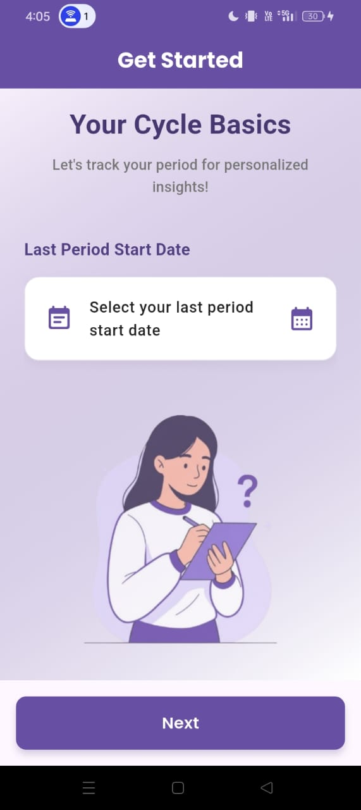 
      <i>Personalized onboarding to tailor your experience.</i>
    </td>
    <td align="center">
      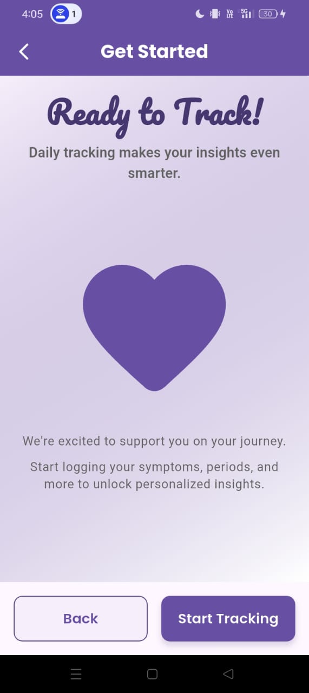 
      <i>Setting up your profile for intelligent insights.</i>
    </td>
  </tr>
</table>

---

### Intelligent Tracking in Action

<table>
  <tr>
    <td align="center">
      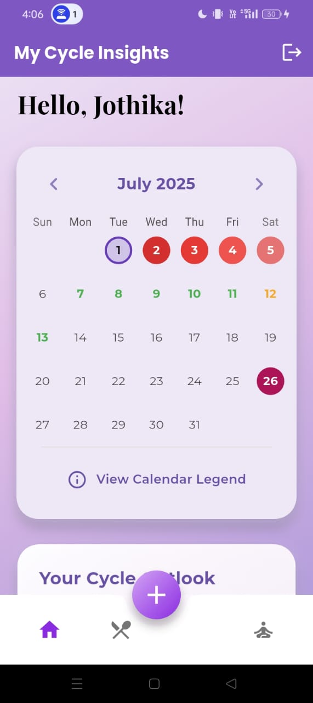 
      <i>Intuitive cycle calendar with AI-driven predictions and easy daily logging.</i>
    </td>
    <td align="center">
      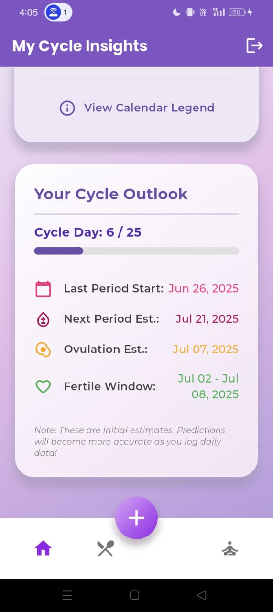 
      <i>Dive deeper into your cycle patterns and symptoms.</i>
    </td>
  </tr>
  <tr>
    <td align="center">
      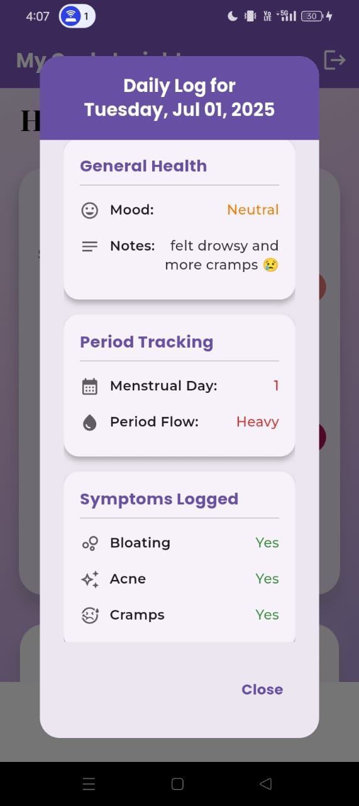 
      <i>Comprehensive logging for accurate symptom analysis.</i>
    </td>
    <td align="center">
      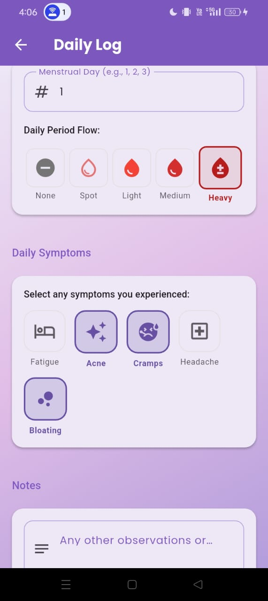 
      <i>AI-powered predictions at a glance.</i>
    </td>
  </tr>
</table>

---

### AI-Powered Food Analysis

#### Cooked Food Analysis

<table>
  <tr>
    <td align="center">
      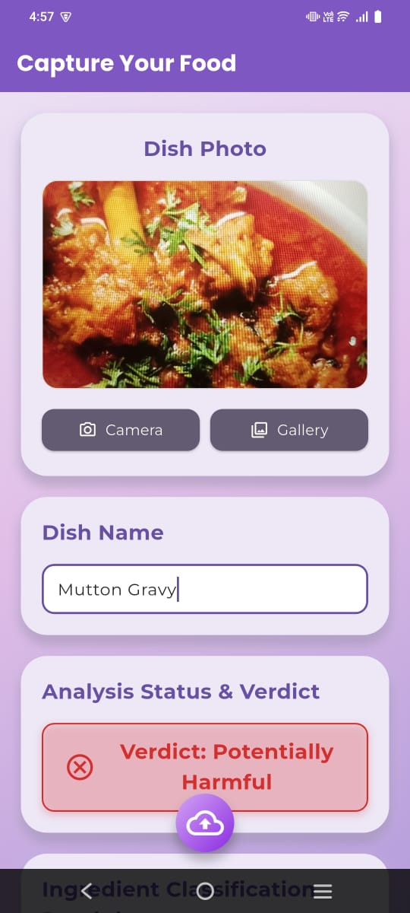 
      <i>Analyzing a home-cooked meal for PCOS suitability.</i>
    </td>
    <td align="center">
      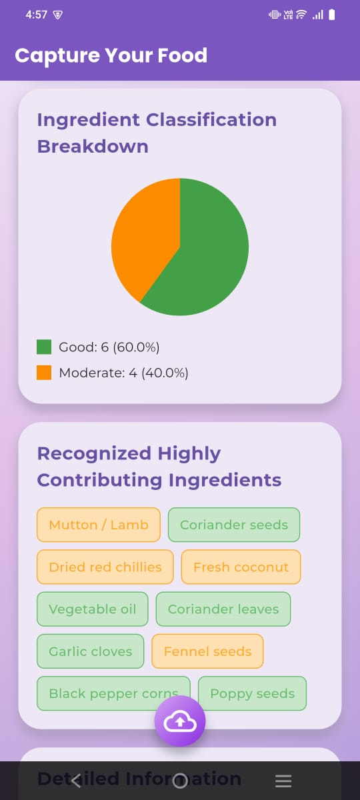 
      <i>Detailed breakdown of nutritional components.</i>
    </td>
    <td align="center">
      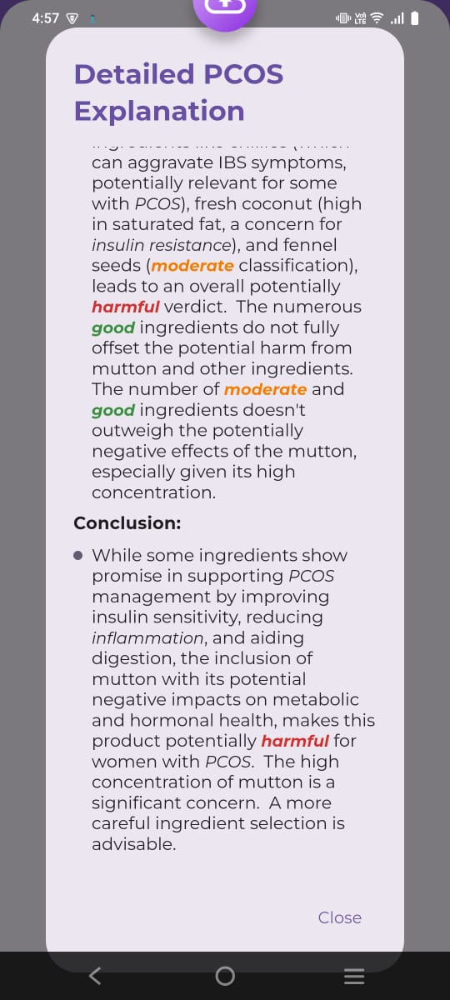
    </td>
  </tr>
</table>

---

#### Packed Food Analysis

<table>
  <tr>
    <td align="center">
      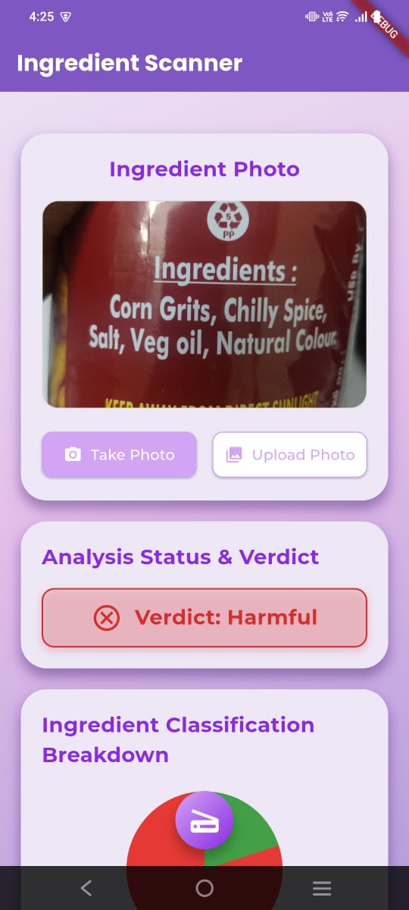 
      <i>Scanning the label of a packaged food item.</i>
    </td>
    <td align="center">
      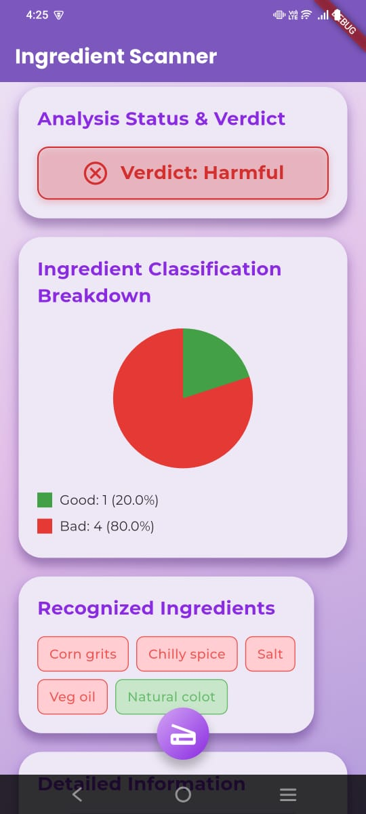 
      <i>Instant analysis for potential dietary concerns.</i>
    </td>
  </tr>
  <tr>
    <td align="center" colspan="2">
      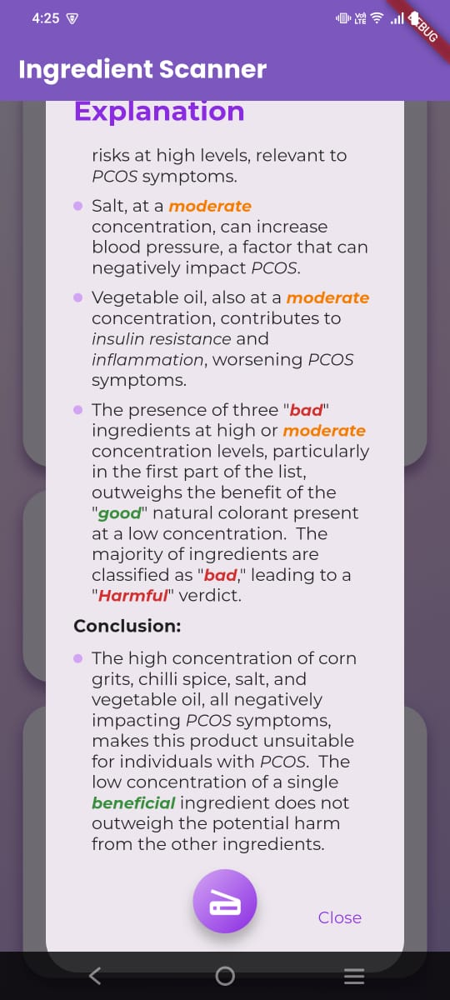
    </td>
  </tr>
</table>

---

### Interactive Self-Care with AI Pose Matching

<table>
  <tr>
    <td align="center">
      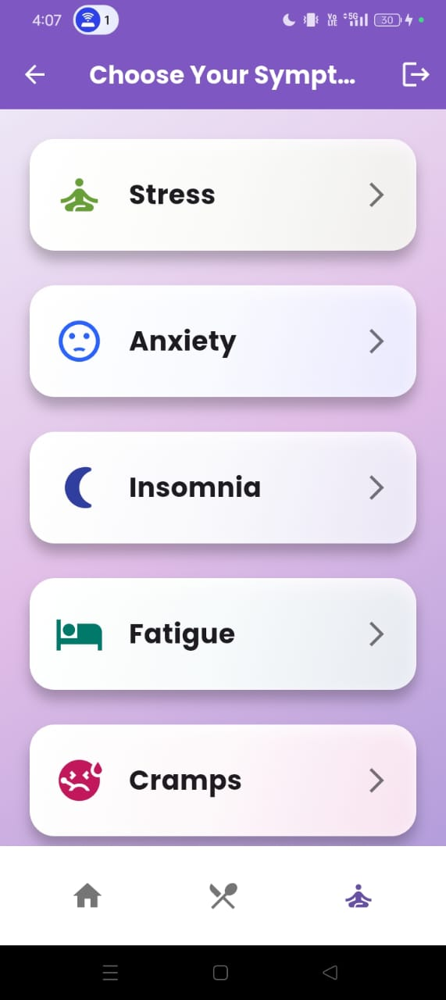 
      <i>Your personalized hub for well-being.</i>
    </td>
    <td align="center">
      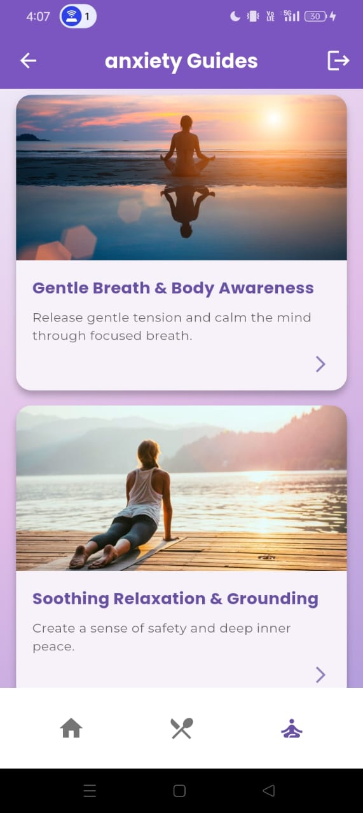 
      <i>Choose from a variety of guided yoga routines.</i>
    </td>
  </tr>
  <tr>
    <td align="center" colspan="2">
      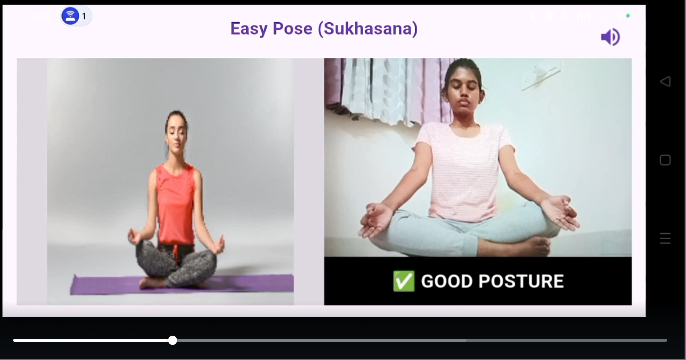 
      <i>Real-time feedback for perfect form.</i>
    </td>
  </tr>
</table>

## ⚙️ Backend System Visuals

  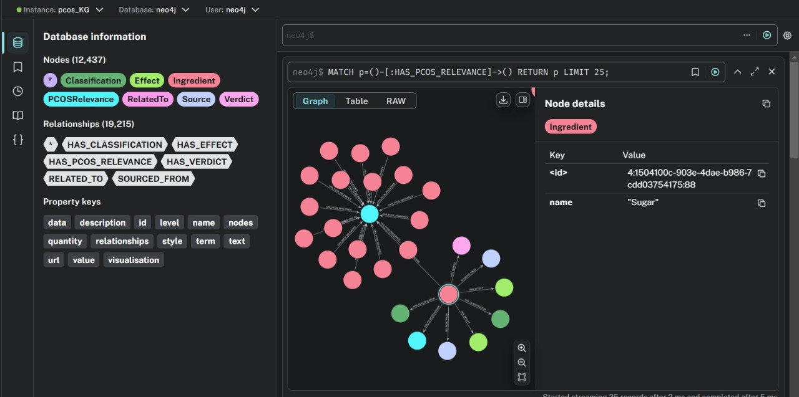
   
  <i>Neo4j knowledge graph structure for food insights.</i>

## 💻 Technology Stack

  
  
  
  
  
  
  
  
  
  
  
  
  

## 🚀 Setup and Installation

The current app uses **MongoDB through FastAPI** for accounts, profiles and daily logs.
Firebase is no longer required. Follow [MONGODB_SETUP.md](MONGODB_SETUP.md) for database,
backend, Flutter configuration, testing, and migration instructions.

Start `backend/account_api.py` on port **8002**. The existing food APIs remain separate:
`main.py` on **8000** and `main2.py` on **8001**. Their food datasets and model configuration
must be supplied before food analysis works.

## 👥 Team Aether

FemWise is designed and built by **Team Aether**.

## 🙏 Acknowledgements

* Built for **Chaos**. Thanks to the Chaos organizers for the opportunity to build FemWise!
