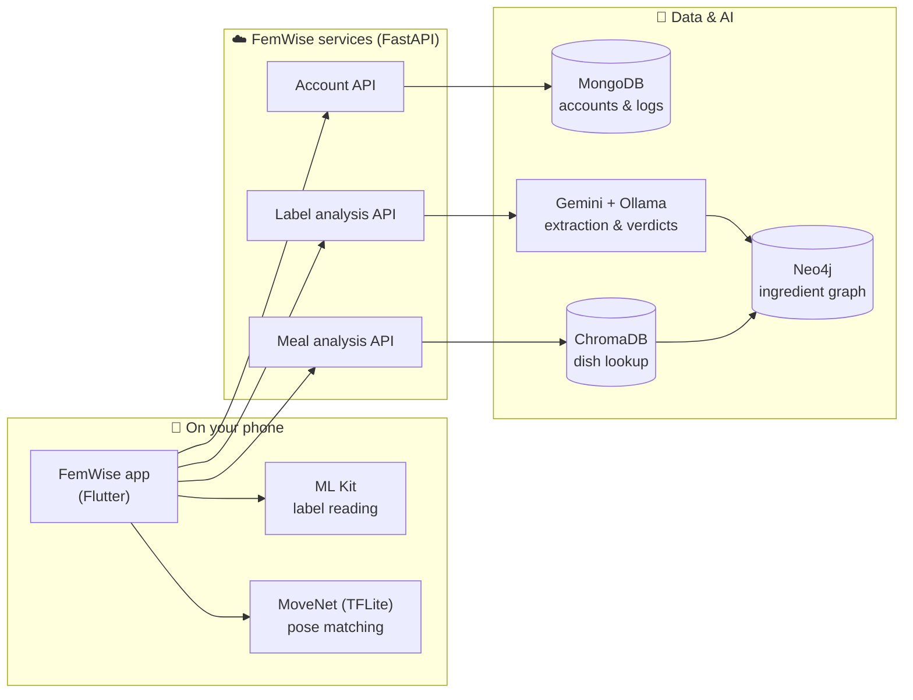

<div align="center">


# FemWise

### Your intelligent PCOS companion for Android

**Track smarter. Eat better. Breathe easier.**

[](https://femwise-ai.vercel.app)
[](https://github.com/suhavani23/femwise)
[](#-download)
[](#-tech-stack)
[](#-team)

[**🌐 Visit the website**](https://femwise-ai.vercel.app) · [**📲 Download the APK**](https://femwise-ai.vercel.app/#download) · [**💻 App source code**](https://github.com/suhavani23/femwise) · [**⚙️ How it works**](#️-how-it-works)

</div>

---

## 💭 The problem

Polycystic Ovary Syndrome affects roughly **1 in 10 women**. Managing it means a hundred small decisions every day:

- 📅 *When is my next period?* Irregular cycles make ordinary trackers useless.
- 🍽️ *Is this safe to eat?* Food labels are confusing and generic nutrition apps don't know what matters for PCOS.
- 🧘‍♀️ *How do I calm down tonight?* Self-care advice is one-size-fits-all.

Most women end up juggling three apps and still guessing.

## ✨ The solution

**FemWise** brings cycle tracking, AI food analysis and guided self-care into **one calm, personalised app**, so every decision gets easier.

<div align="center">
<table>
  <tr>
    <td align="center"><br /><b>Cycle calendar</b></td>
    <td align="center"><br /><b>Food verdict</b></td>
    <td align="center"><br /><b>Guided routines</b></td>
  </tr>
</table>
</div>

## 🌟 What FemWise does

| | Feature | What you get |
|:-:|---|---|
| 📅 | **Cycle tracking & prediction** | A visual calendar marks your current period, predicted next period, ovulation day and fertile window. Log flow, mood and symptoms daily and watch the outlook update. |
| 🔍 | **Packaged-food scanner** | Point the camera at an ingredient label. FemWise reads it, checks every ingredient against a PCOS knowledge graph and gives a clear verdict with healthier swaps. |
| 🍛 | **Cooked-meal analysis** | Snap a home-cooked dish, type its name, and get an ingredient breakdown rated for PCOS suitability. |
| 🧘‍♀️ | **Guided self-care** | Choose stress, anxiety or insomnia and follow yoga poses and breathing exercises built for that concern. |
| 📷 | **Real-time pose matching** | Your camera compares your posture to the reference pose and tells you instantly when your form is right. Runs fully on your phone. |
| 🔒 | **Private by design** | Argon2 password hashing, short-lived sessions, and no video or database credentials ever leave the device. |

## ⚙️ How it works



<details>
<summary><b>🔎 Food analysis, step by step</b></summary>
<br />

1. **Capture.** The user photographs a label or a cooked dish.
2. **Read.** Google ML Kit extracts the label text on-device.
3. **Extract.** An LLM (Ollama) turns the raw text into a clean ingredient list.
4. **Look up.** Each ingredient is matched in a **Neo4j knowledge graph** holding its effect on PCOS, a verdict and alternatives. Cooked dishes are first mapped to their typical ingredients through **ChromaDB**.
5. **Explain.** Gemini writes a plain-language summary with healthier swaps.
6. **Show.** The app displays an overall verdict and an ingredient breakdown chart.

</details>

<details>
<summary><b>🧘‍♀️ Pose matching, step by step</b></summary>
<br />

1. The routine shows a reference pose and its instructions.
2. A **MoveNet Lightning** model (TensorFlow Lite) estimates the user's body keypoints from the live camera feed.
3. The app compares those keypoints to the reference and shows **Good posture** or guidance to adjust.
4. Everything runs on the phone. No video is uploaded anywhere.

</details>

<details>
<summary><b>🔐 Accounts and data</b></summary>
<br />

- Sign-up and sign-in go through the FastAPI **Account API**.
- Passwords are hashed with **Argon2**; sessions use random bearer tokens that expire after 7 days and are revoked on logout.
- Profiles and daily logs live in **MongoDB**. A day's log and the cycle status are saved in one atomic update.
- The app never holds a database connection string.

</details>

## 📸 Screens

<div align="center">
<table>
  <tr>
    <td align="center"><br />Onboarding</td>
    <td align="center"><br />Calendar</td>
    <td align="center"><br />Daily log</td>
    <td align="center"><br />Log details</td>
  </tr>
  <tr>
    <td align="center"><br />Meal scan</td>
    <td align="center"><br />Label scan</td>
    <td align="center"><br />Verdict</td>
    <td align="center"><br />Self-care</td>
  </tr>
</table>
</div>

## 📲 Download

> **Free, direct APK. Android 6.0 or newer.**

1. Open the download page: **[femwise-ai.vercel.app/#download](https://femwise-ai.vercel.app/#download)**
2. Tap **Download APK** and open the file. If Android asks, allow installs from this source (normal for apps outside Google Play).
3. Sign up, answer a few questions about your cycle, and you're in.

## 🛠️ Tech stack

<div align="center">


</div>

| Layer | Technology | Role |
|---|---|---|
| App | Flutter, Dart | Cross-platform UI, calendar, logging, camera flows |
| On-device ML | Google ML Kit, TensorFlow Lite (MoveNet) | Label text recognition, real-time pose estimation |
| Backend | FastAPI (Python) | Account, label-analysis and meal-analysis services |
| Storage | MongoDB | Accounts, profiles, daily logs |
| Knowledge | Neo4j | Ingredient → effect → verdict → alternative graph |
| Retrieval | ChromaDB | Dish name → typical ingredients |
| Inference | OpenAI | Ingredient extraction and plain-language verdicts |
| Website | HTML, CSS, JavaScript on Vercel | Landing page and APK download |

## 🧭 Project links

| | Link |
|---|---|
| 🌐 Website | [femwise-ai.vercel.app](https://femwise-ai.vercel.app) |
| 💻 App source (Flutter + FastAPI) | [github.com/suhavani23/femwise](https://github.com/suhavani23/femwise) |
| 🖥️ Website source | [github.com/parasmani-dev/Femwise](https://github.com/parasmani-dev/Femwise) |

<details>
<summary><b>🚀 Run the app locally</b></summary>
<br />

**Backend (account API)**

```bash
cd backend
python -m venv .venv
.venv/Scripts/activate        # Windows  |  source .venv/bin/activate on macOS/Linux
pip install -r requirements-accounts.txt
cp .env.example .env          # set MONGODB_URI
uvicorn account_api:app --env-file .env --host 0.0.0.0 --port 8002 --reload
```

**App**

```bash
flutter pub get
flutter run --dart-define=ACCOUNT_API_URL=http://10.0.2.2:8002
```

`10.0.2.2` reaches your computer from the Android emulator. On a real phone, use your PC's LAN IP. The food-analysis services need Neo4j, ChromaDB and model keys configured separately.

</details>

## 🗺️ Roadmap

- [ ] Smarter cycle predictions that learn from logged history
- [ ] Barcode lookup for packaged foods
- [ ] More self-care programs and longer routines
- [ ] Google Play release

## 👥 Team

Built with care by **Team Aether**: designers and engineers who believe PCOS care should feel intelligent and kind.

---

<div align="center">

*FemWise is a wellness companion, not a medical device. Always consult a healthcare professional.*

**If FemWise resonates with you, a ⭐ on this repo means a lot.**

</div>
